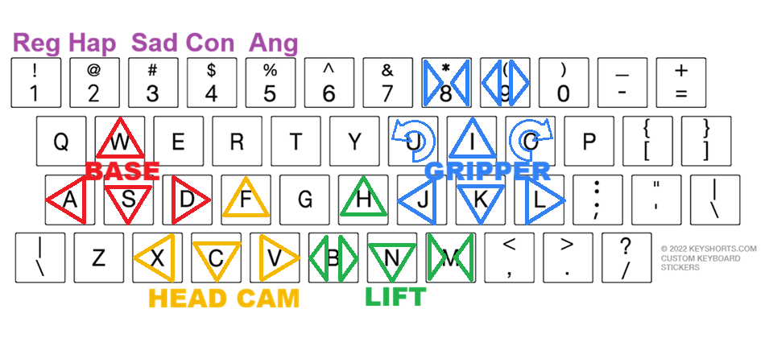
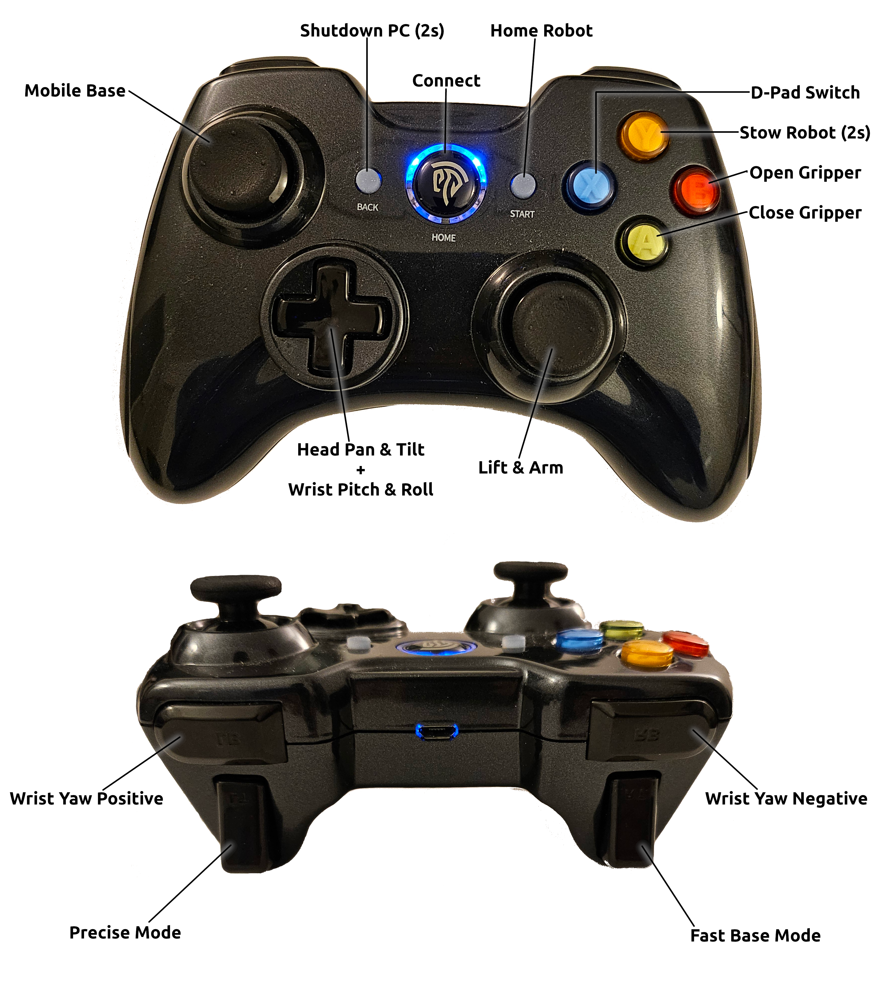

## Stretch Robot Clown 

This is a custom LED eye module design for the Hello-Robot RE2. This Eye module displays different emotions (sad, angry, happy, confuse, and normal (staring)) and can gaze utilizing the tilt-pan camera located on the robot. 

**How to run**

1) activate the conda environment { conda activate clown }

2) run the Hello-Robot calibration code {stretch_robot_home.py} Remember to remove the clip!

3) Run the launch file { ros2 launch stretch_core stretch_driver.launch.py }

4) Run the keyboard teleop { ros2 run robot_clown keyboard_driver }

Or with Xbox controller run: ros2 launch stretch_core stretch_driver.launch.py mode:=gamepad

**Show the Cameras**
Main head camera
- In new terminal: ros2 launch stretch_core d435i_basic.launch.py
- Add \camera topic
Gripper camera
- In new terminal: 
- Add \gripper_cam topic

ros2 run rviz2 rviz2 -d /home/hello-robot/clown_ws/src/robot_clown/robot_clown/basic_cams.rviz
